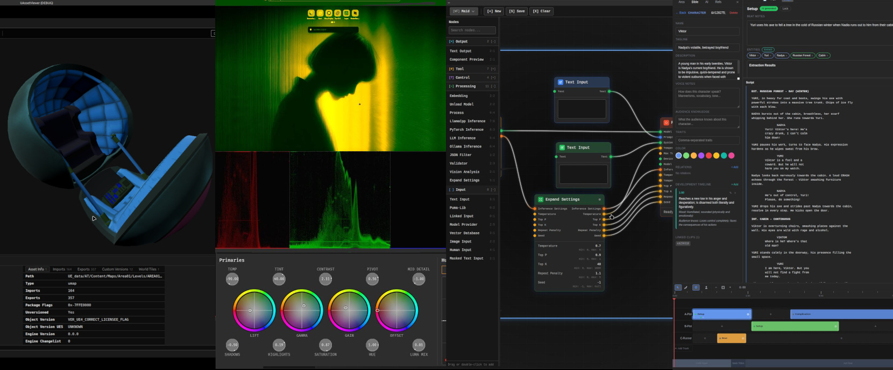

# Agent-First Systems, Graphs & Creative Tools

**[View my portfolio →](https://mrscripty.github.io/MrScripty/)**

I develop independent, reusable projects that can support many applications. Some began as experiments, and many contain areas of active research. Practical applications give that research real problems to solve and ways to test the results. Ideas can move between projects without becoming runtime dependencies.

## Models, workflows & agent-first development

| Project | Purpose & current direction |
| --- | --- |
| [Pumas Library](https://github.com/MrScripty/Pumas-Library) | A Rust model-management layer for local AI deployment: acquisition, downloads, storage, metadata and shared configuration so apps can reuse models without duplicating files. Inference plugins support development and testing. |
| [Pantograph](https://github.com/MrScripty/Pantograph) | Node-based AI workflows across inference backends, with retained data and execution history for later inspection. Resource-aware scheduling that looks ahead across the graph is in development. |
| [Chrema](https://github.com/MrScripty/Chrema) | Agent composition from reusable components, designed to make inputs, decisions and outputs observable so people and other agents can inspect and refine them. Pumas models → Pantograph execution → Chrema composition describes the wider design; integrations are developing separately. |
| [Passeur](https://github.com/MrScripty/Passeur) | Local coding-agent delegation across providers, with durable tasks and repository coordination. Research into overlapping edits and structural coordination aims to reduce intervention and integration conflicts. |
| [Coding Standards](https://github.com/MrScripty/Coding-Standards) | Domain-modeling and agent-interface research using a graph-memory engine. Current typed MCP tools expose navigation and retained workflow state; the broader aim is agent-transparent observability for studying and improving interactions. |
| [Whip Docs](https://github.com/MrScripty/whip-docs) | A visual workspace in development for understanding code structure and collaborating with coding agents: inspecting designs and proposed changes, then guiding the work through the same interface. Current prototypes combine a file-and-symbol graph with an intent journal. |
| [Eidetic](https://github.com/MrScripty/Eidetic) | A clip-based knowledge graph for shaping context over time. The aim is to move, trim, split and rearrange clips to control which graph information contributes to context and output; screenwriting is one application. |
| [Pumas Playground](https://github.com/MrScripty/Pumas-Playground) | A local developer workbench for inspecting a running Pumas gateway, trying individual model operations and reviewing responses and receipts. It uses an existing runtime rather than installing models or inference providers. |

## Creative tools & applications

| Project | Purpose & current direction |
| --- | --- |
| [Pentimento](https://github.com/MrScripty/Pentimento) | A Bevy rendering workspace with several web and native frontend approaches, providing a practical setting for hybrid-interface development. Linux is the current supported platform. |
| [Crispen](https://github.com/MrScripty/Crispen) | Reusable color-correction and grading tools, designed for standalone adjustments or embedding in other creative software. |
| [Korino-Reaves](https://github.com/MrScripty/Korino-Reaves) | A fork-based Unreal asset-inspection and modding workbench, combining Godot, Svelte and native tooling to inspect, compare and extract assets. |
| [Tuldok](https://github.com/MrScripty/Tuldok) | Create and curate model-training datasets, review the data, and follow workflows through to training results. Current work includes image data and small-model experiments. |
| [Book-Be-Gone](https://github.com/MrScripty/Book-Be-Gone) | A personal book-digitization utility: capture pages with a webcam, run OCR, review the result and export editable Markdown. |
| [Commonlight](https://github.com/MrScripty/Commonlight) | A portrait-studio prototype for BC + AI members, with consent-based capture, restrained photo cleanup, consistent presentation and optional shareable galleries. |
| [Lanternwake](https://github.com/MrScripty/Lanternwake) | An in-development Godot/C# 3D visual novel exploring guided and adaptive storytelling with local AI. The authored island mystery is distinct from optional AI conversations; current model-deployment and real-microphone qualification remain pending. |

## Physics & simulation research

| Project | Purpose & current direction |
| --- | --- |
| [Rheon](https://github.com/MrScripty/Rheon) | A general 3D fluid-physics solver in development, intended to generate training data for faster AI surrogate simulation. Current native solver work and its UI remain distinct from surrogate experiments. |
| [Rheon Surrogate Lab](https://github.com/MrScripty/rheon-surrogate-lab) | Controlled experiments replacing Rheon's iterative pressure solve with learned models, retaining numerical comparisons and timing evidence. Results belong to their documented fixed-box conditions, not a general speed or accuracy guarantee. |
| [Kenoma](https://github.com/MrScripty/Kenoma) | Soft- and rigid-body physics research toward anatomically detailed muscle and skeleton simulation, including contracting soft bodies. Current posing tools and held-arm prototypes explore parts of that larger goal. |

## Books & research

I write about the methods behind this work, from training models and producing datasets to making engineering decisions from evidence.

| Book | Focus |
| --- | --- |
| [Training Your Own Models on One 24 GB GPU](https://bc-ai-ecosystem.github.io/training-your-own-models/) | A project-first handbook spanning language, vision, embeddings, and other model families, with interactive learning tools. Vibe Authored by Dr.Puma; I transferred the project to BC+AI. |
| [Practical Data Analysis for Engineering Decisions](https://mrscripty.github.io/practical-data-analysis/) | Measurement, fair comparisons, uncertainty, and turning analysis into engineering decisions, with nine interactive examples and a reproducible companion. [Source](https://github.com/MrScripty/practical-data-analysis). |
| [Dataset Production](https://mrscripty.github.io/dataset-production/) | A methods-first fieldbook on building, reviewing, and releasing datasets, with educational examples covering labels, splits, synthetic data, and provenance. [Source](https://github.com/MrScripty/dataset-production). |

My other books include *Cooking the Cat*, *Contribution Belonging and Shared Power*, and *Knowledge Graphs and Agentic Memory*. *Cooking the Cat* is a personal account of my development approach, assembled by an agent analyzing engineering conversations.

The [Pantograph research collection](https://github.com/MrScripty/Pantograph/blob/b09380618224277e21fc5be2a2fe7ccc21e9d7dd/docs/research/README.md) brings together a book and papers on compatible inference backends, node execution, provenance, and resource-safe scheduling, plus a scheduler simulation report. These research editions document evidence and proposals that inform development.

## Longer-term direction

[Studio Whip](https://github.com/MrScripty/Studio-Whip) was the original starting point: a collaborative creative-production application for film and other visual storytelling. It remains a longer-term goal, with substantial foundational work and integration still ahead. The same foundations are intended for additional applications beyond the projects outlined here.

These projects are at different stages. Their repositories document current capabilities and work in progress; the connections here explain how practical tools and research inform each other.

---

<!-- GH_STATS_START -->

 
 
<!-- GH_STATS_END -->

