# Dark portfolio appearance review

**Review branch only; not deployed.** The page now has a compact dark palette, separate stacked Tuldok and Eidetic sections, current actual Pantograph workbench captures, the approved cleaner Kenoma held-arm scene beside the mannequins, shipped Pumas/Pantograph icons, a full Whip Docs visual section, and a featured Coding Standards / Cooking the Cat pairing.

[Full desktop preview](dark-desktop.png) · [Full mobile preview](dark-mobile.png) · [Source and remaining blockers](../portfolio/DARK_REVIEW.md) · [Icon inventory](../portfolio/ICON_AUDIT.md) · [Validation](../portfolio/VALIDATION.md)

| Desktop | Mobile |
| --- | --- |
| 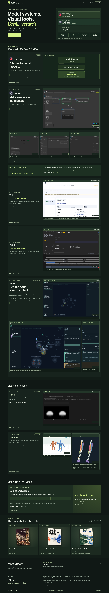 | 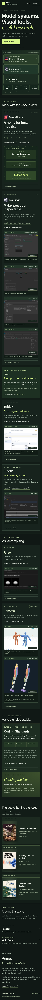 |
| 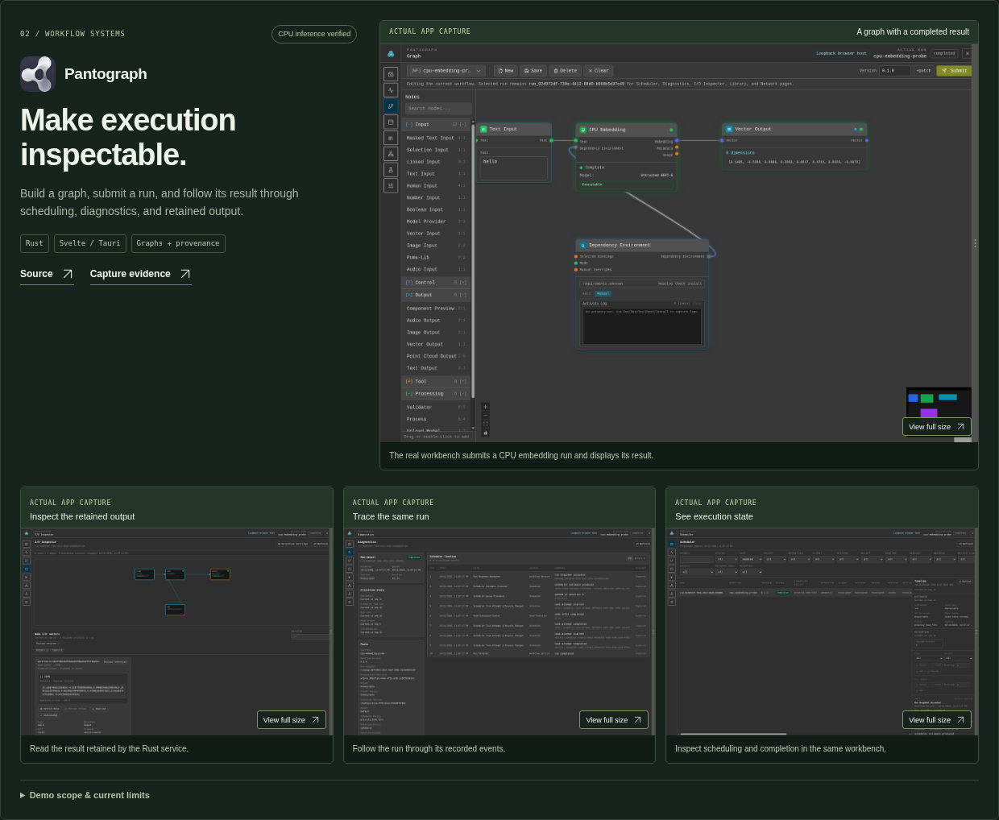 | 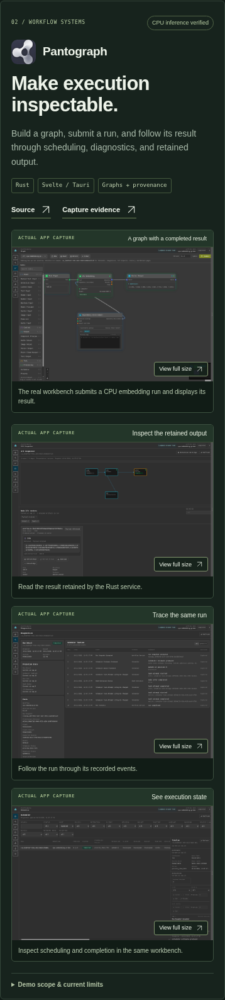 |
| 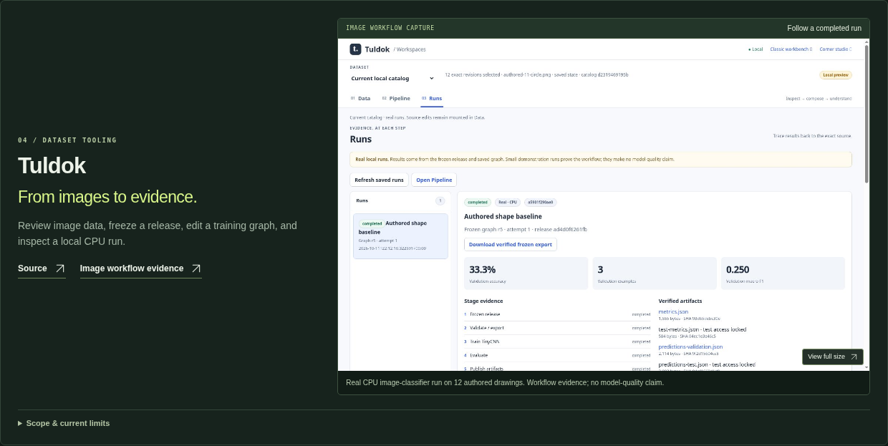 | 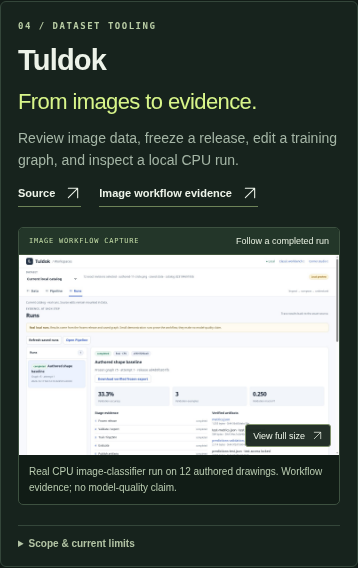 |
| 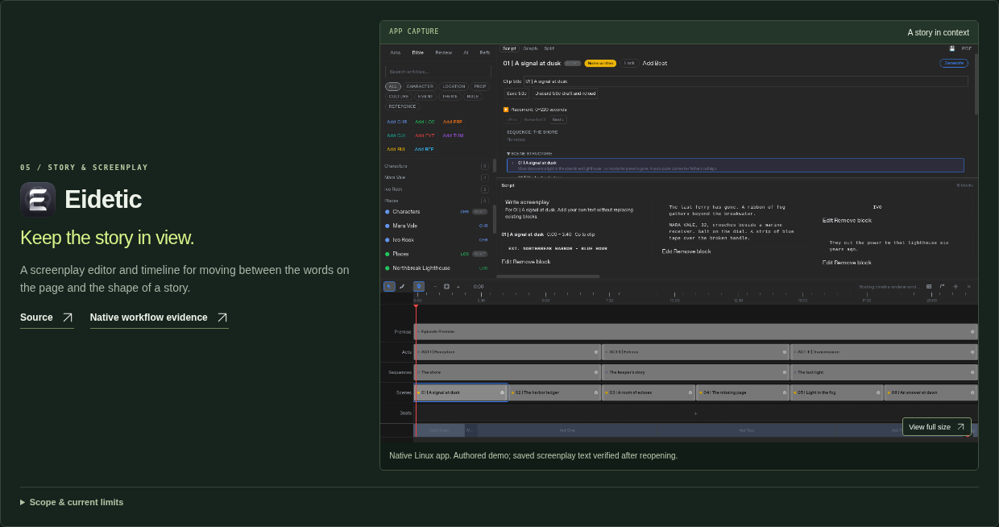 | 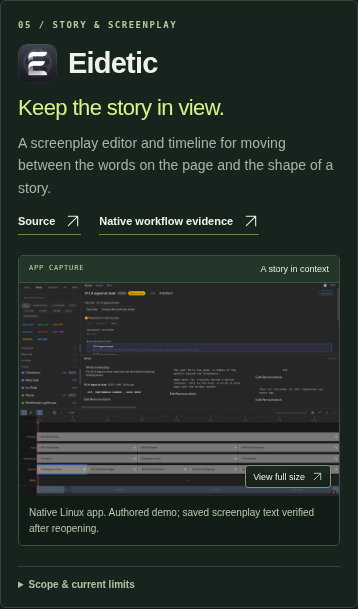 |
| 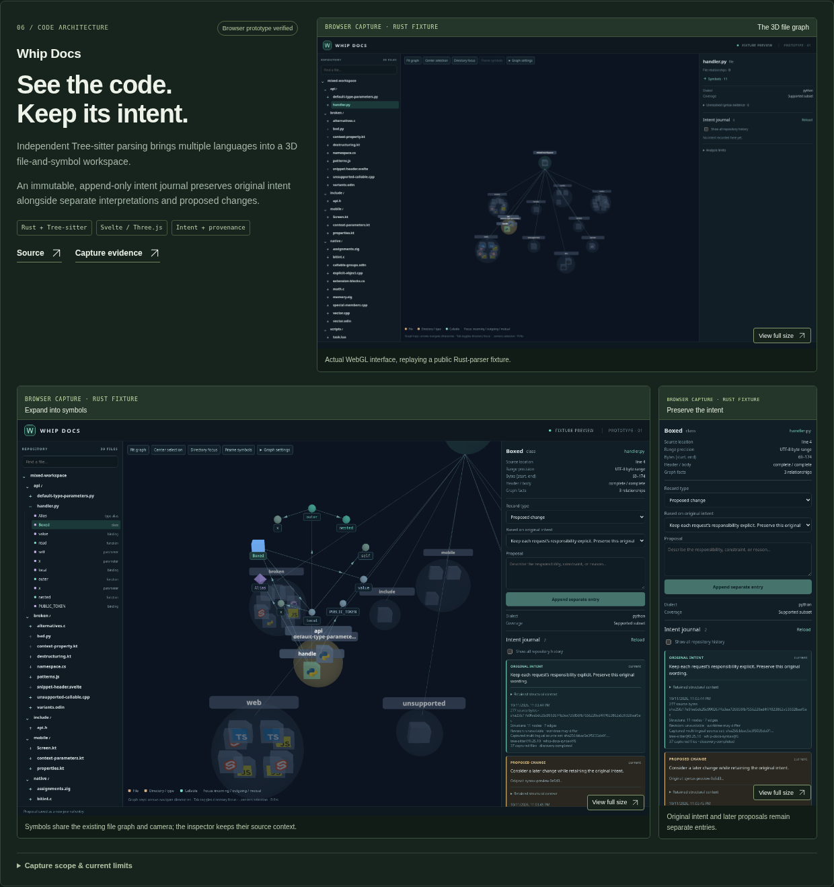 | 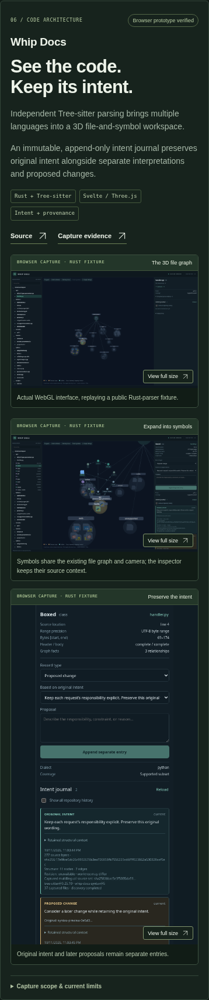 |
| 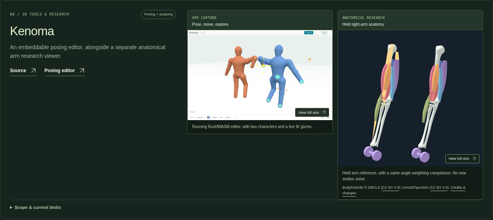 | 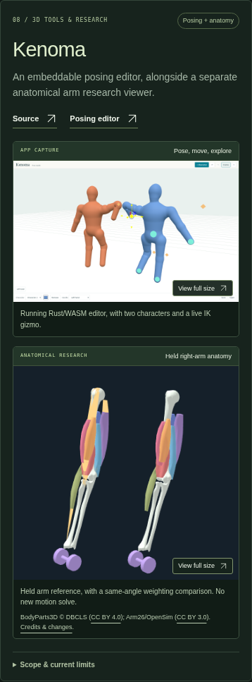 |
| 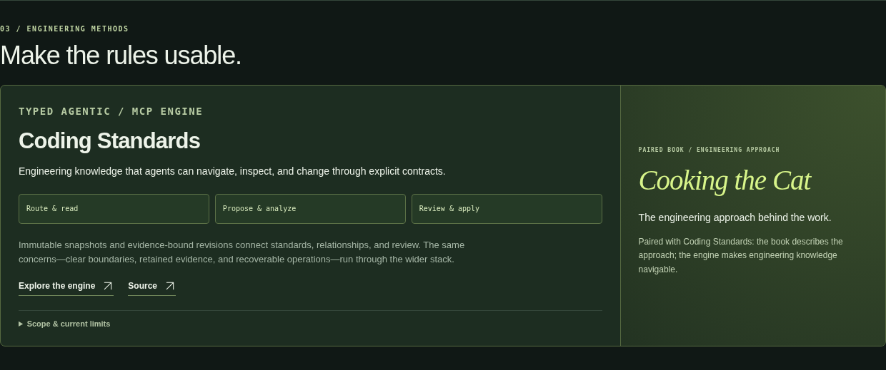 | 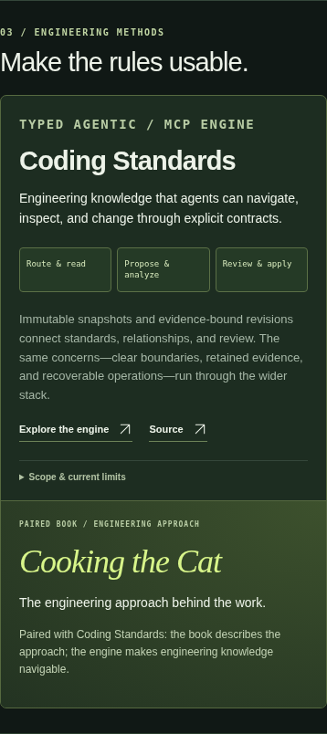 |
| 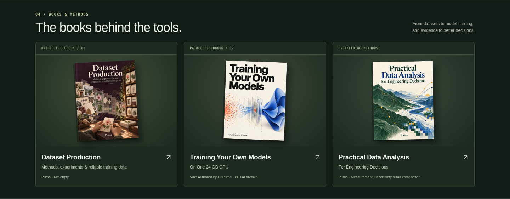 |  |

The owner-confirmed original Eidetic icon is pending its location; the earlier placeholder-file finding was not a complete asset conclusion.

The Pumas architecture diagram is explicitly authored, not a GUI capture. An actual public Library GUI image is still needed. Cooking the Cat has the owner-provided title and description but awaits its public book URL and original cover. The low-resolution Rheon candidate was not selected; the earlier solver comparison remains qualified by its caption.

The existing Pages publication remains `e0ddbf9811044cf2bbd25af4e6527032d2abd701`. The previously approved cream design and its historical image-addition previews are retained below as an archive, not the current appearance.

---

# Portfolio appearance review

Reviewed design, 11 October 2026. The desktop/book/mobile previews below show the approved appearance from `b600137`, now published at Pages commit `e0ddbf9811044cf2bbd25af4e6527032d2abd701`. These are screenshots of the static site, not new app captures. The later Tuldok and Kenoma previews farther down remain source-only.

| Desktop | Mobile |
| --- | --- |
| 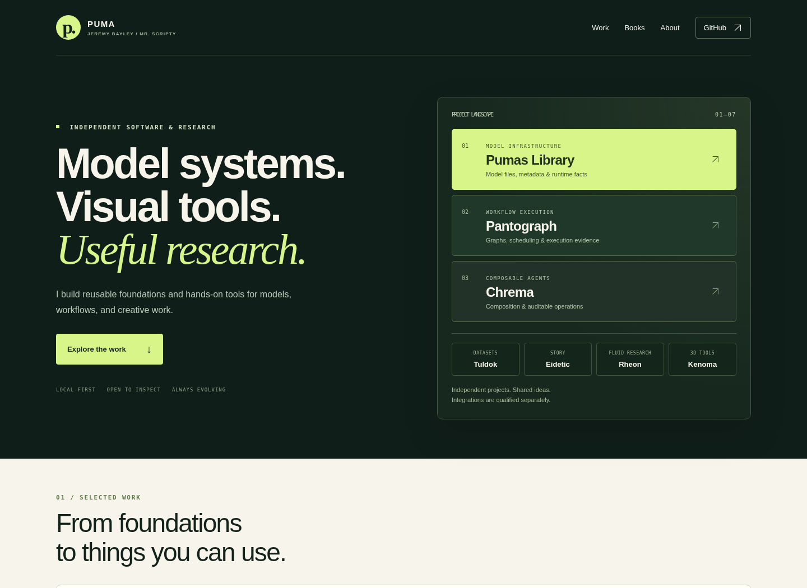 | 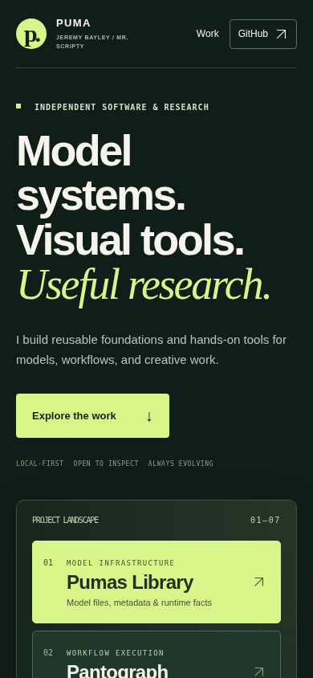 |
| 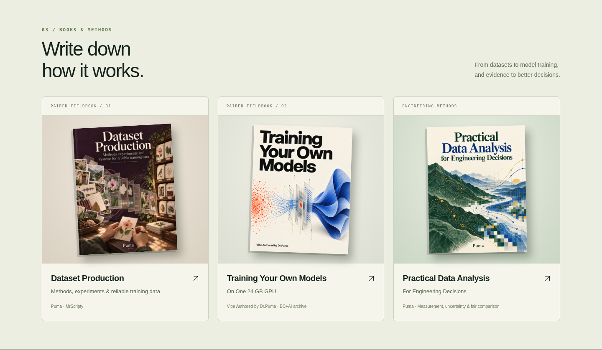 | 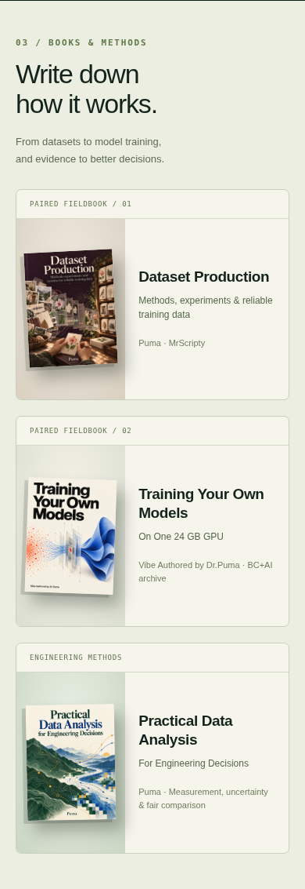 |

The landscape includes Chrema after Pumas and Pantograph, using only the existing public description. Original public book covers preserve distinct attribution. The approved Eidetic native capture remains present. Shared research interests are distinguished from qualified app integrations.

The complete page can be previewed with Python's local HTTP server from `docs/portfolio/`. It passed desktop/tablet/phone checks, keyboard navigation, nine screenshot dialogs and no-JavaScript reading. See [validation](../portfolio/VALIDATION.md), [image audit](../portfolio/IMAGE_AUDIT.md) and [source notes](../portfolio/SOURCES.md).

Fresh Pantograph Graph/Scheduler/Network and improved Rheon captures are pending with their application workers. The page preserves current genuine evidence and its limitations. The core visual direction is approved and published. Later image additions still require applicable appearance review and publication approval.

## Tuldok image-workspace addition

A real completed CPU image-classifier run on 12 authored CC0 drawings, with frozen source/graph, validation metrics and verified artifacts. The image demonstrates workflow behavior, not useful model quality; audio and 3D training are not claimed.

| Desktop card | Mobile card |
| --- | --- |
| 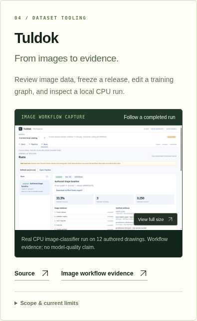 | 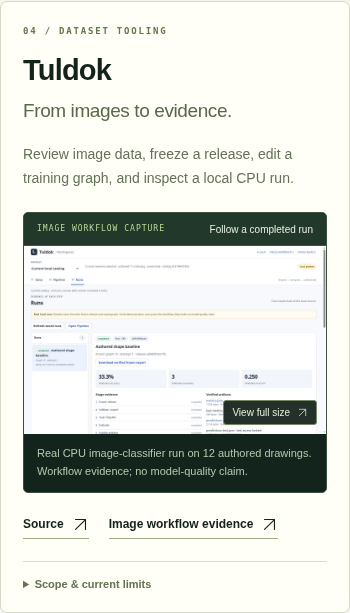 |

This new card remains source-only and is excluded from the published `b600137` design.

## Kenoma arm apparatus addition

The existing schematic poser is now paired with a genuine capture of the separate anatomical right-arm viewer. It shows held reference geometry, not a new motion solve or validated whole-body simulation. Both original images remain unchanged and enlarge to their full size. Dataset credits, component licenses and source limits are retained.

| Desktop card | Mobile card |
| --- | --- |
| 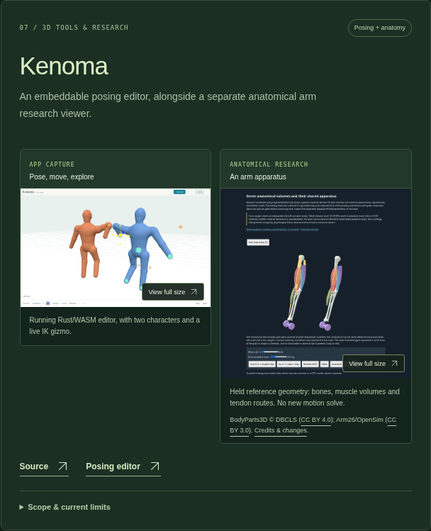 | 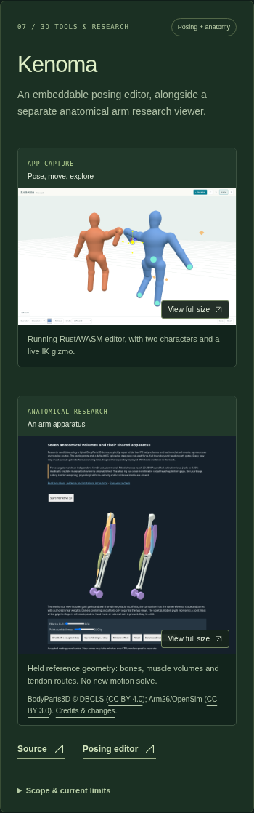 |

This addition also remains source-only and is excluded from the published `b600137` design.
