# Purpose, typography and gallery review

**Review revision; not deployed.** Purpose-first descriptions, consistent white project headlines, compact manual image galleries and a lower-priority Lanternwake row beneath the books. The live site remains at Pages commit `396dc13`.

[Exact revised copy and source checks](../portfolio/COPY_REVIEW.md) · [Full desktop preview](purpose-desktop.png) · [Full mobile preview](purpose-mobile.png) · [Validation](../portfolio/VALIDATION.md)

| Desktop | Mobile |
| --- | --- |
| 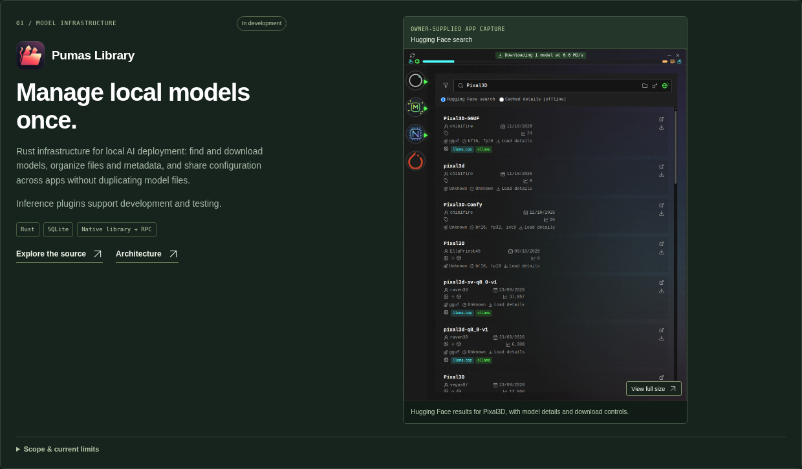 | 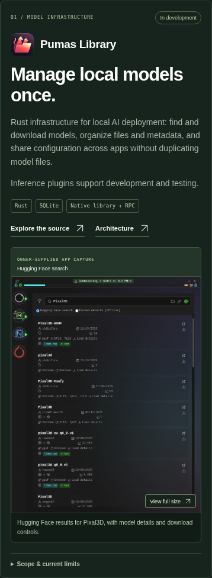 |
| 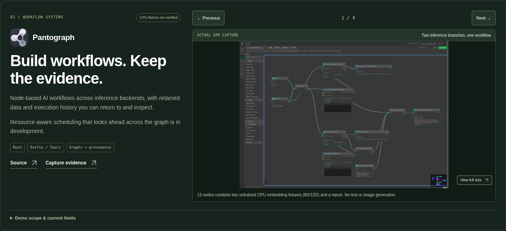 | 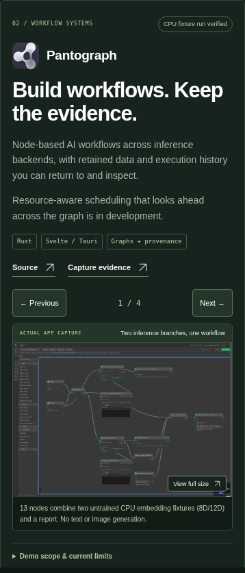 |
| 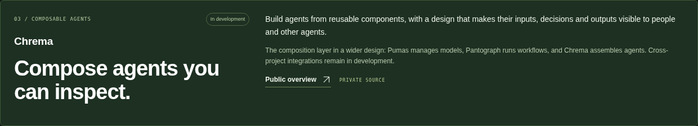 | 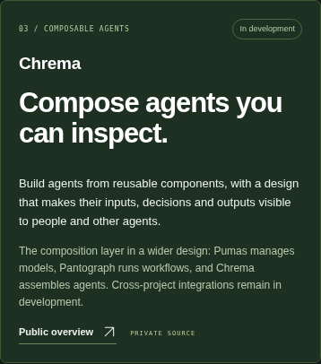 |
| 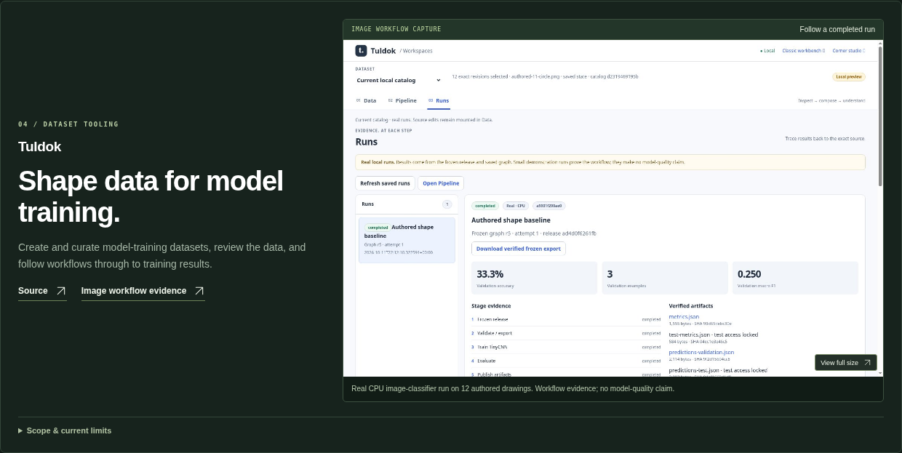 | 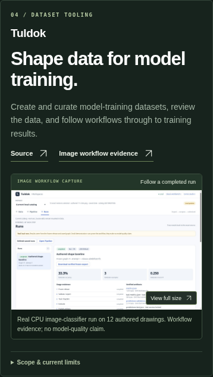 |
| 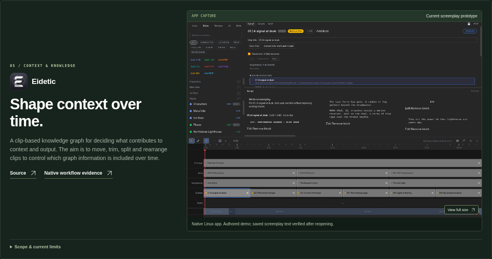 | 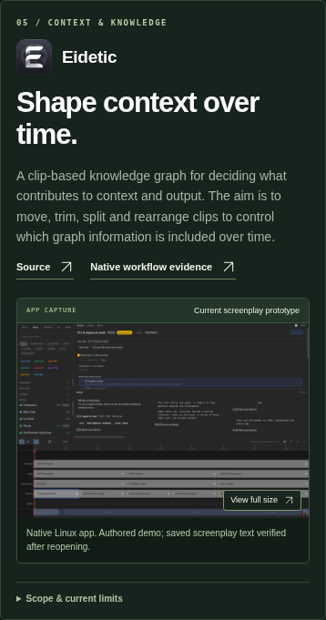 |
| 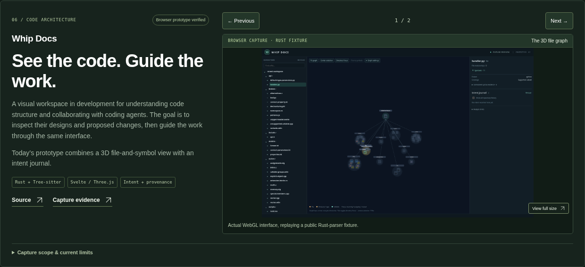 | 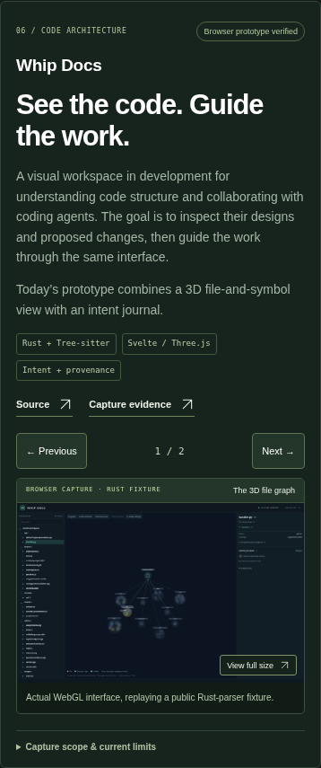 |
| 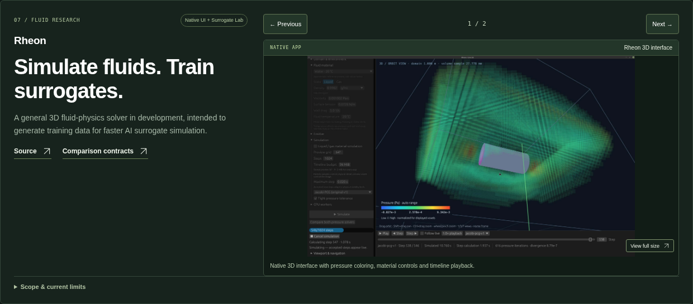 | 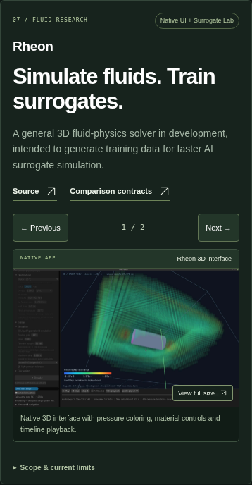 |
| 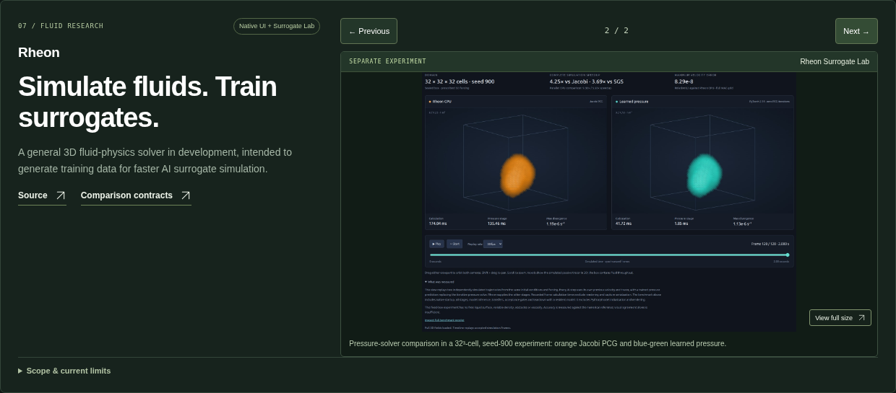 | 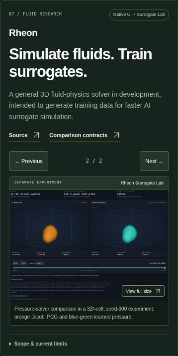 |
| 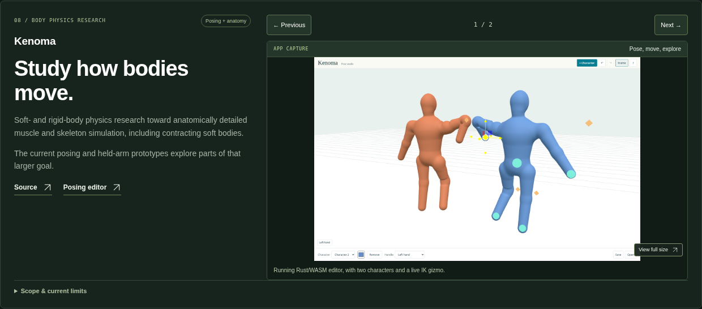 | 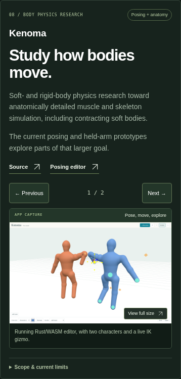 |
| 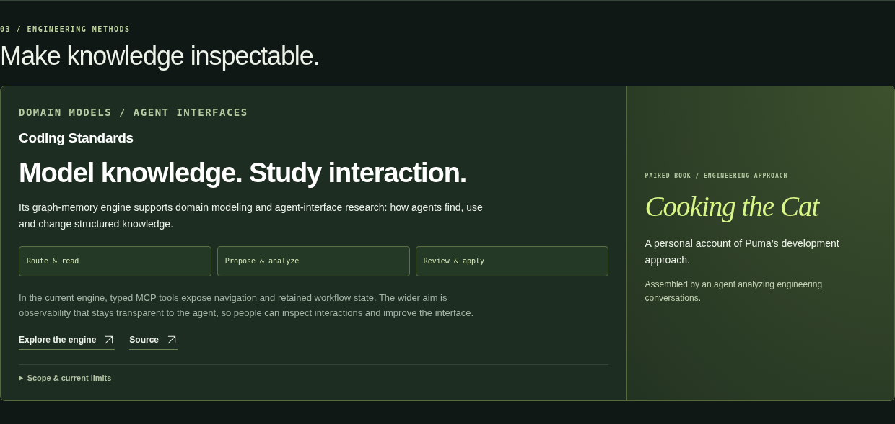 | 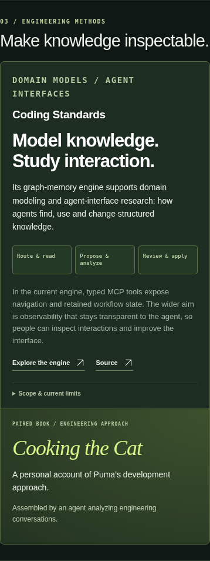 |
| 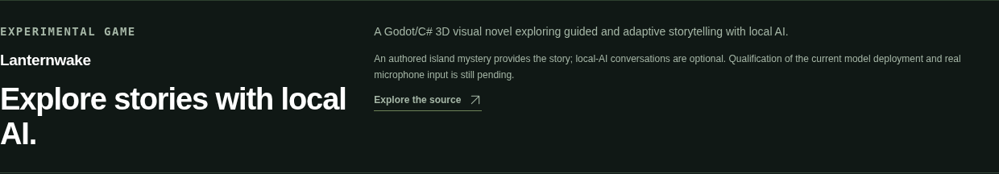 | 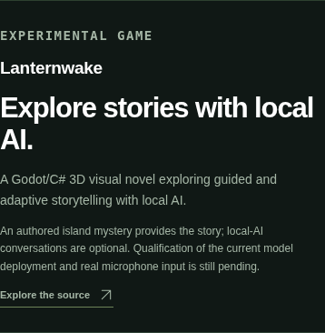 |

The galleries are manual: Previous/Next, a count, a short fade and reduced-motion support. Full-size images, original captions and keyboard/history focus are retained. No book manuscript or cover is included. Chrema retains its existing public-overview link pending repository confirmation.

---

# Earlier reviewed appearances (historical)

# Dark portfolio appearance review

**Rheon UI + Surrogate Lab update for review; not deployed.** The page now has the owner’s profile photograph in the header, a compact dark palette, separate stacked Tuldok and Eidetic sections, the richer 13-node Pantograph CPU fixture run with matching standalone inspection views, the approved cleaner Kenoma held-arm scene beside the mannequins, original Pumas/Pantograph/Eidetic icons, the owner-supplied Pumas Hugging Face search view, a full Whip Docs visual section, the owner-supplied Rheon native UI and separate Surrogate Lab comparison, and a featured Coding Standards / Cooking the Cat pairing.

[Full desktop preview](dark-desktop.png) · [Full mobile preview](dark-mobile.png) · [Source and remaining blockers](../portfolio/DARK_REVIEW.md) · [Icon inventory](../portfolio/ICON_AUDIT.md) · [Validation](../portfolio/VALIDATION.md)

| Desktop | Mobile |
| --- | --- |
|  |  |
|  |  |
| 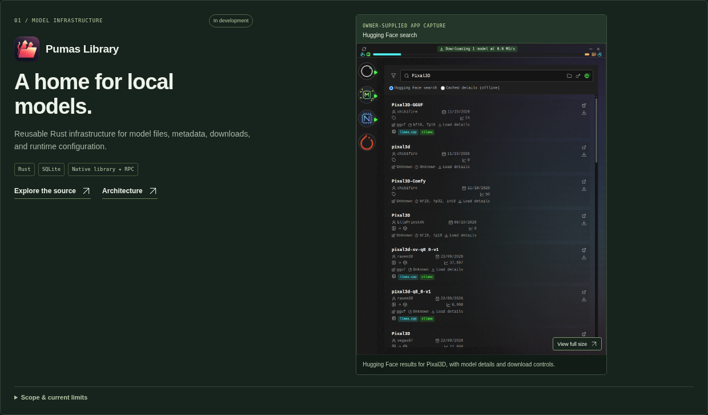 | 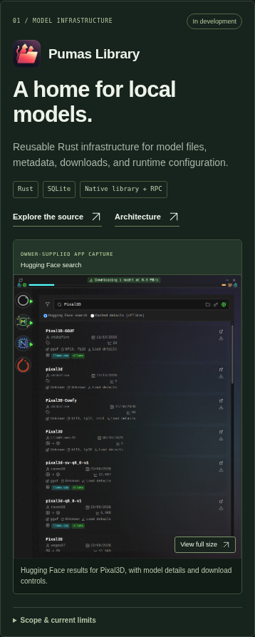 |
|  |  |
|  |  |
|  |  |
|  |  |
| 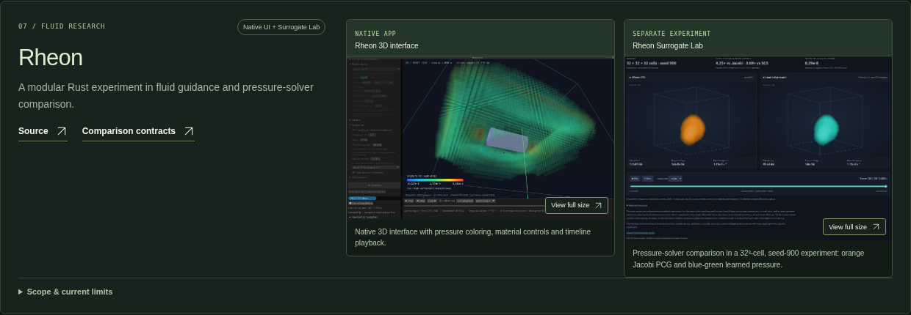 | 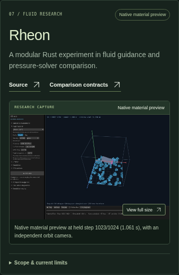 |
|  |  |
|  |  |
|  |  |

The Pantograph gallery now shows two actual untrained CPU embedding fixtures (8D/12D) and their combined report. Text/image generation is not demonstrated. All four views come from the same completed run.

Whip Docs retains the two distinct graph views; the repeated standalone inspector entry has been removed.

Eidetic now displays the owner’s original 512 × 512 icon, published at root `icon.png` in commit `cc80011` and copied without pixel edits.

The Pumas gallery shows only the owner-supplied Hugging Face search. The error-bearing Library view has been removed from the rendered gallery; its original source file remains intact while a healthy replacement is pending. The screenshot does not qualify a specific app revision or inference result. Cooking the Cat has the owner-provided title and description but awaits its public book URL and original cover. Rheon now shows the owner-supplied native UI and a separately labeled Surrogate Lab experiment: orange CPU/Jacobi PCG beside blue-green learned pressure, in a 32³-cell sealed box with seed 900. Original JPEGs and their proportions are preserved. Timing and error readings are specific to the pictured experiment; no general speedup or accuracy claim is added. These changes have not been deployed.

The existing dark Pages publication remains `7b5847785c76388c00205a68f36145d401ff62b3`; it still uses the older Rheon comparison image. The previously approved cream design and its historical image-addition previews below are retained as an archive.

---

# Portfolio appearance review

Reviewed design, 11 October 2026. The desktop/book/mobile previews below show the approved appearance from `b600137`, now published at Pages commit `e0ddbf9811044cf2bbd25af4e6527032d2abd701`. These are screenshots of the static site, not new app captures. The later Tuldok and Kenoma previews farther down remain source-only.

| Desktop | Mobile |
| --- | --- |
|  |  |
|  |  |

The landscape includes Chrema after Pumas and Pantograph, using only the existing public description. Original public book covers preserve distinct attribution. The approved Eidetic native capture remains present. Shared research interests are distinguished from qualified app integrations.

The complete page can be previewed with Python's local HTTP server from `docs/portfolio/`. It passed desktop/tablet/phone checks, keyboard navigation, nine screenshot dialogs and no-JavaScript reading. See [validation](../portfolio/VALIDATION.md), [image audit](../portfolio/IMAGE_AUDIT.md) and [source notes](../portfolio/SOURCES.md).

Fresh Pantograph Graph/Scheduler/Network and improved Rheon captures are pending with their application workers. The page preserves current genuine evidence and its limitations. The core visual direction is approved and published. Later image additions still require applicable appearance review and publication approval.

## Tuldok image-workspace addition

A real completed CPU image-classifier run on 12 authored CC0 drawings, with frozen source/graph, validation metrics and verified artifacts. The image demonstrates workflow behavior, not useful model quality; audio and 3D training are not claimed.

| Desktop card | Mobile card |
| --- | --- |
|  |  |

This new card remains source-only and is excluded from the published `b600137` design.

## Kenoma arm apparatus addition

The existing schematic poser is now paired with a genuine capture of the separate anatomical right-arm viewer. It shows held reference geometry, not a new motion solve or validated whole-body simulation. Both original images remain unchanged and enlarge to their full size. Dataset credits, component licenses and source limits are retained.

| Desktop card | Mobile card |
| --- | --- |
|  |  |

This addition also remains source-only and is excluded from the published `b600137` design.
